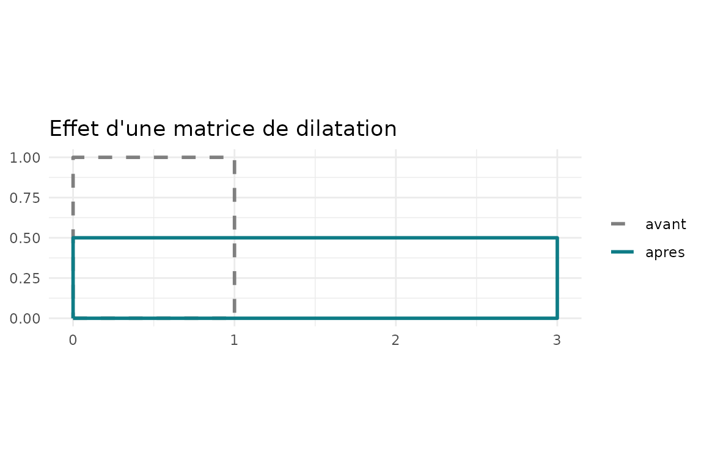
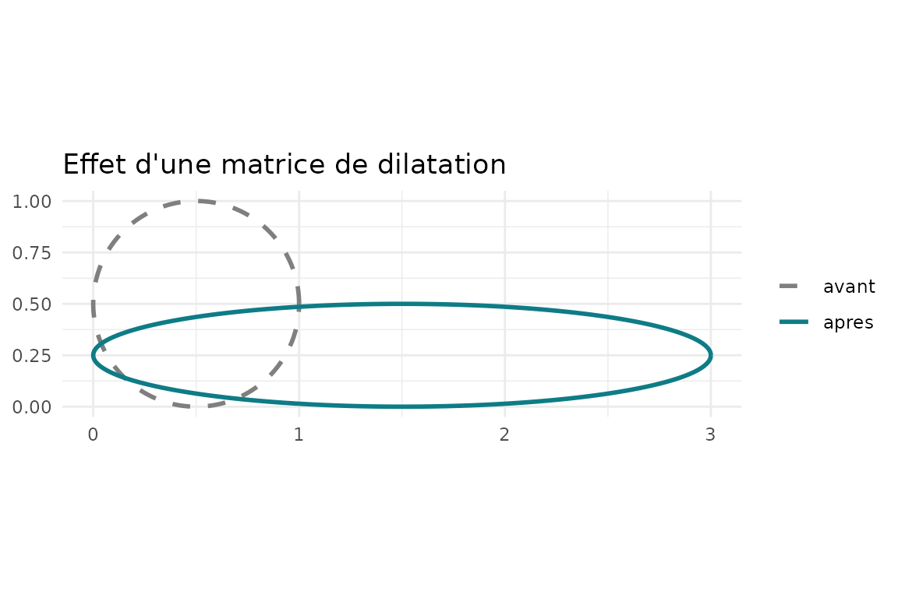
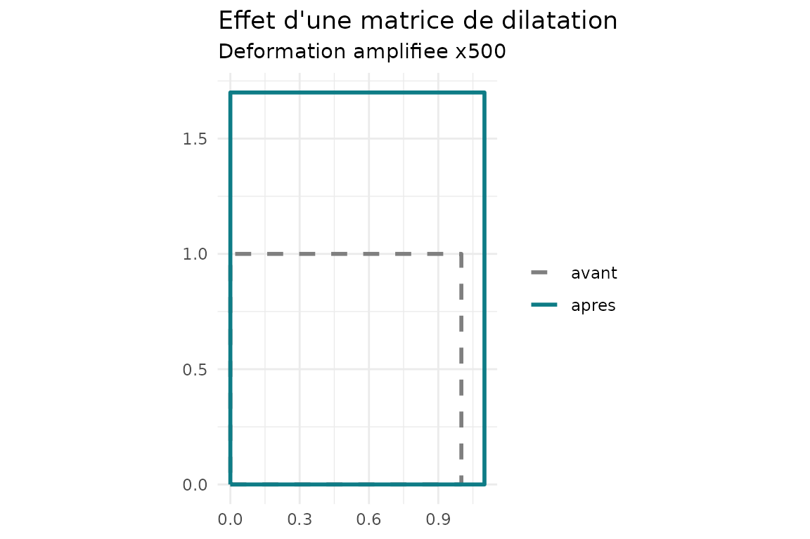
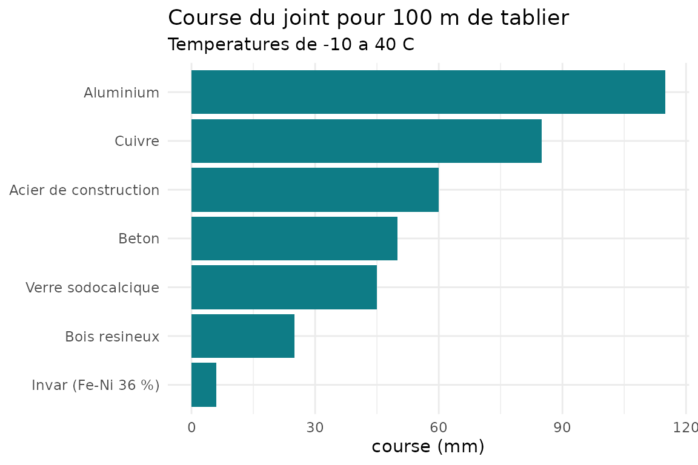

# Dimensionner un joint de pont avec dilatR

## Le problème

Un tablier de pont s’allonge quand il chauffe et se raccourcit quand il
refroidit. Le **joint de dilatation** laisse ce mouvement se produire
librement ; s’il est trop petit, la structure est contrainte. Si
l’allongement est totalement empêché, la contrainte vaut \\\sigma =
E\\\alpha\\\Delta T\\ : pour l’acier (\\E = 210\\ \mathrm{GPa}\\,
\\\alpha = 12\times10^{-6}\\ \mathrm{K}^{-1}\\) et \\\Delta T = 30\\
\mathrm{K}\\, cela fait environ \\76\\ \mathrm{MPa}\\ sans aucune
charge.

Ce tutoriel suit la démarche du package : une **matrice de dilatation**
décrit la déformation, ses propriétés (déterminant, valeurs propres) ont
un sens physique, puis on l’applique au dimensionnement d’un joint.

``` r

library(dilatR)
```

[← Retour au
sommaire](https://metagueu.github.io/dilatR/articles/sommaire.md)

## 1. La matrice de dilatation

En dimension \\n\\, une matrice de dilatation est une matrice diagonale
à coefficients strictement positifs :

\\ D = \mathrm{diag}(s_1, \ldots, s_n) = \begin{pmatrix} s_1 & & \\ &
\ddots & \\ & & s_n \end{pmatrix}, \qquad s_i \> 0 . \\

Elle multiplie l’axe \\i\\ par le facteur \\s_i\\ : \\x'\_i =
s_i\\x_i\\. Si tous les facteurs sont égaux, \\D = s\\I_n\\ : la
dilatation est *isotrope* et la forme est conservée. Sinon elle est
*anisotrope*.

``` r

D <- dilat_matrice(c(3, 0.5))
D
#>      [,1] [,2]
#> [1,]    3  0.0
#> [2,]    0  0.5
```

### Le cas thermique

La loi de dilatation linéique, valable pour de petites variations de
température, donne directement le facteur de dilatation \\s\\ :

\\ L = L_0\\(1 + \alpha\\\Delta T) \quad\Longrightarrow\quad s =
\frac{L}{L_0} = 1 + \alpha\\\Delta T, \qquad \Delta T = T -
T\_{\mathrm{ref}} . \\

Chaque axe peut avoir son propre coefficient \\\alpha_i\\ (bois,
composites) : \\s_i = 1 + \alpha_i\\\Delta T\\. Les unités comptent :
\\\alpha\\ s’exprime en \\\mathrm{K}^{-1}\\, donc `12e-6` et non `12`.

``` r

dilat_thermique(alpha = 12e-6, dT = 50, dim = 3)
#>        [,1]   [,2]   [,3]
#> [1,] 1.0006 0.0000 0.0000
#> [2,] 0.0000 1.0006 0.0000
#> [3,] 0.0000 0.0000 1.0006
```

## 2. Appliquer la matrice à des points

Les points sont rangés en lignes, un point par ligne. Pour une matrice
\\X\\ de points, le résultat est

\\ X' = X\\D^{\mathsf T} . \\

``` r

carre <- rbind(c(0, 0), c(1, 0), c(1, 1), c(0, 1))
dilat_appliquer(D, carre)
#>      [,1] [,2]
#> [1,]    0  0.0
#> [2,]    3  0.0
#> [3,]    3  0.5
#> [4,]    0  0.5
```

Le carré unité devient un rectangle \\3 \times 0{,}5\\.
[`dilat_plot()`](https://metagueu.github.io/dilatR/reference/dilat_plot.md)
dessine la forme avant (pointillés) et après (trait plein) :

``` r

dilat_plot(D, "carre")
```



Un cercle devient une ellipse de demi-axes \\0{,}5\\s_1\\ et
\\0{,}5\\s_2\\ :

``` r

dilat_plot(D, "cercle")
```



## 3. Lire les propriétés

\\ \det D = \prod\_{i=1}^{n} s_i , \qquad D\\\mathbf{e}\_i =
s_i\\\mathbf{e}\_i , \qquad \kappa = \frac{s\_{\max}}{s\_{\min}} \ge 1 .
\\

Le déterminant est le facteur par lequel les volumes (les aires en 2D)
sont multipliés ; les valeurs propres sont les facteurs le long des axes
principaux ; \\\kappa = 1\\ si et seulement si la dilatation est
isotrope.

``` r

dilat_resume(D)
#> $facteurs
#> [1] 3.0 0.5
#> 
#> $det
#> [1] 1.5
#> 
#> $variation_pct
#> [1] 50
#> 
#> $valeurs_propres
#> [1] 3.0 0.5
#> 
#> $anisotropie
#> [1] 6
#> 
#> $isotrope
#> [1] FALSE
```

L’inverse ramène à la forme initiale, et la composition multiplie les
facteurs :

\\ D^{-1} = \mathrm{diag}\\\left(\frac1{s_1}, \ldots,
\frac1{s_n}\right), \qquad D_1 D_2 = \mathrm{diag}(s_1 t_1, \ldots, s_n
t_n) = D_2 D_1 . \\

``` r

D %*% dilat_inverse(D)
#>      [,1] [,2]
#> [1,]    1    0
#> [2,]    0    1
dilat_composer(dilat_matrice(c(2, 3)), dilat_matrice(c(4, 0.5)))
#>      [,1] [,2]
#> [1,]    8  0.0
#> [2,]    0  1.5
```

## 4. Un matériau anisotrope : le bois

Dans le sens des fibres (axe \\x\\), le bois se dilate beaucoup moins
que dans le sens transversal.

``` r

bois <- dilat_thermique(c(5e-6, 35e-6), dT = 40)
bois
#>        [,1]   [,2]
#> [1,] 1.0002 0.0000
#> [2,] 0.0000 1.0014
dilat_resume(bois)$anisotropie
#> [1] 1.0012
```

Les dilatations thermiques sont minuscules (\\\varepsilon \approx
10^{-3}\\) : sans précaution, les deux formes se superposent sur le
dessin. L’argument `amplif` exagère l’écart à 1 : \\s_i^{\text{tracé}} =
1 + a\\(s_i - 1)\\, et le facteur \\a\\ est écrit sur le graphique.

``` r

dilat_plot(bois, amplif = 500)
```



## 5. Dimensionner un joint de pont

Seul le facteur de dilatation selon l’axe du tablier compte. Avec
\\L_0\\ la longueur dilatable, \\\alpha\\ le coefficient et \\m\\ la
marge de sécurité :

\\ \Delta L\_{\max} = L_0\\\alpha\\(T\_{\max} - T\_{\mathrm{ref}}),
\qquad \Delta L\_{\min} = L_0\\\alpha\\(T\_{\min} - T\_{\mathrm{ref}}),
\\

\\ C = \Delta L\_{\max} - \Delta L\_{\min} = L_0\\\alpha\\(T\_{\max} -
T\_{\min}), \qquad C\_{\text{joint}} = C\\(1 + m) . \\

Pour un tablier acier de 100 m, posé à \\10\\ ^\circ\mathrm{C}\\, entre
\\-10\\ ^\circ\mathrm{C}\\ et \\40\\ ^\circ\mathrm{C}\\ :

``` r

dilat_joint(L0 = 100, alpha = 12e-6, T_min = -10, T_max = 40, T_ref = 10)
#> $allongement_mm
#> [1] 36
#> 
#> $raccourcissement_mm
#> [1] -24
#> 
#> $course_mm
#> [1] 60
#> 
#> $capacite_mm
#> [1] 72
```

On lit : allongement de 36 mm, raccourcissement de 24 mm, course de 60
mm, donc un joint de 72 mm avec 20 % de marge.

### Comparer des matériaux

Le jeu de données `materiaux` fournit des coefficients de dilatation. On
calcule la course du joint pour chaque matériau (le composite
carbone/époxy est exclu : son \\\alpha_x\\ est négatif).

``` r

utiles <- materiaux[materiaux$alpha_x > 0, ]
utiles$course_mm <- vapply(
  utiles$alpha_x,
  function(a) dilat_joint(100, a, -10, 40, T_ref = 10)$course_mm,
  numeric(1)
)
knitr::kable(
  utiles[order(-utiles$course_mm), c("materiau", "course_mm")],
  row.names = FALSE, digits = 1
)
```

| materiau              | course_mm |
|:----------------------|----------:|
| Aluminium             |       115 |
| Cuivre                |        85 |
| Acier de construction |        60 |
| Beton                 |        50 |
| Verre sodocalcique    |        45 |
| Bois resineux         |        25 |
| Invar (Fe-Ni 36 %)    |         6 |

``` r

utiles$materiau <- factor(utiles$materiau,
                          levels = utiles$materiau[order(utiles$course_mm)])
ggplot2::ggplot(utiles, ggplot2::aes(x = materiau, y = course_mm)) +
  ggplot2::geom_col(fill = "#0E7C86") +
  ggplot2::coord_flip() +
  ggplot2::labs(title = "Course du joint pour 100 m de tablier",
                subtitle = "Temperatures de -10 a 40 C",
                x = NULL, y = "course (mm)") +
  ggplot2::theme_minimal()
```



La course est proportionnelle à \\\alpha\\ : celle de l’aluminium est
près de vingt fois celle de l’Invar.

## Limites du modèle

- **Premier ordre** : \\s = 1 + \alpha\\\Delta T\\ n’est exact que pour
  de petites déformations ; \\D(-\Delta T) \neq D(\Delta T)^{-1}\\, avec
  un écart d’ordre \\(\alpha\\\Delta T)^2\\.
- **\\\alpha\\ constant** : en réalité \\\alpha\\ varie légèrement avec
  la température.
- **Température uniforme, dilatation libre** : pas de gradient dans la
  section, pas d’appui bloqué, pas de retrait ni de fluage du béton.
- **Axes alignés avec le repère** : sinon \\D' = R\\D\\R^{\mathsf T}\\
  avec \\R\\ une rotation (mêmes valeurs propres, axes tournés).
- **Températures simplifiées** : les valeurs réglementaires viennent de
  l’Eurocode 1, actions thermiques (EN 1991-1-5).
- **Valeurs de `materiaux` indicatives** : à remplacer par des valeurs
  sourcées.

[← Sommaire](https://metagueu.github.io/dilatR/articles/sommaire.md) ·
[Suite : remerciements
→](https://metagueu.github.io/dilatR/articles/remerciements.md)
