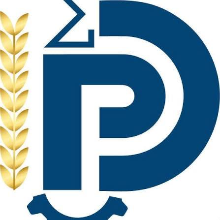

# dilatR

Projet de programmation R · 2026-2027

Matrices de dilatation : de la théorie au dimensionnement des joints de
pont

Présenté par**Ngoufo Metagueu Jordan Christagi**

Matière**INTRODUCTION A R**

Niveau**NIVEAU 3 Science de Données et Intelligence Artificielle**

Enseignant**Mr. NGNEUMEU IVAN**

Établissement**Ecole Nationale Supérieure Polytechnique de Douala**

Année académique**2026-2027**

[Accéder au sommaire
→](https://metagueu.github.io/dilatR/articles/sommaire.md)
