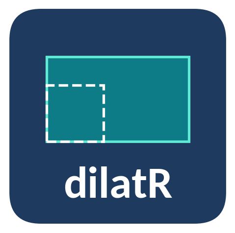

# dilatR

Projet de programmation R · ANNEE_ACAD

Matrices de dilatation : de la théorie au dimensionnement des joints de
pont

Présenté par**NOM_ETUDIANT**

Matière**Programmation R**

Niveau**Niveau 3 · Science des données et IA**

Enseignant**ENSEIGNANT_NOM**

Établissement**ETABLISSEMENT_NOM**

Année académique**ANNEE_ACAD**

[Accéder au sommaire
→](https://metagueu.github.io/dilatR/articles/sommaire.md)
