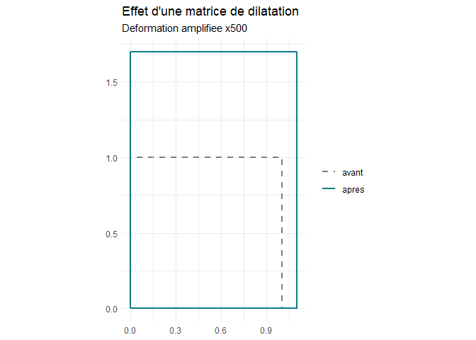

# dilatR

**dilatR** construit, applique, compose et analyse des *matrices de
dilatation* (isotropes ou anisotropes, en 2D ou 3D), calcule la
dilatation thermique linéaire et dimensionne le **joint de dilatation
d’un pont**.

Une matrice de dilatation est une matrice diagonale
`D = diag(s1, ..., sn)` avec `si > 0` : elle multiplie l’axe `i` par le
facteur `si`. Son déterminant donne la variation de volume. En
thermique, `si = 1 + αi·ΔT`, où `αi` est le coefficient de dilatation
linéique selon l’axe `i` et `ΔT` l’écart de température.

## Installation

``` r

# install.packages("remotes")
remotes::install_github("Metagueu/dilatR")
```

## Exemple : le joint d’un tablier acier de 100 m

``` r

library(dilatR)

# Pose à 10 °C, températures extrêmes de -10 à 40 °C
dilat_joint(L0 = 100, alpha = 12e-6, T_min = -10, T_max = 40, T_ref = 10)
#> $allongement_mm
#> [1] 36
#> 
#> $raccourcissement_mm
#> [1] -24
#> 
#> $course_mm
#> [1] 60
#> 
#> $capacite_mm
#> [1] 72
```

Il faut prévoir un joint de 72 mm (course de 60 mm, plus 20 % de marge).
Avec le jeu de données `materiaux` fourni par le package, on compare
avec le béton :

``` r

a <- materiaux$alpha_x[materiaux$materiau == "Beton"]
dilat_joint(100, a, -10, 40, T_ref = 10)$capacite_mm
#> [1] 60
```

## La matrice derrière le calcul

``` r

D <- dilat_thermique(12e-6, dT = 30, dim = 3)
D
#>         [,1]    [,2]    [,3]
#> [1,] 1.00036 0.00000 0.00000
#> [2,] 0.00000 1.00036 0.00000
#> [3,] 0.00000 0.00000 1.00036
dilat_resume(D)$variation_pct
#> [1] 0.1080389
```

Pour un matériau anisotrope comme le bois (fibres selon x), la
déformation dépend de la direction. Les dilatations thermiques sont
minuscules : `amplif` les exagère pour que le dessin soit lisible (le
facteur est écrit sur le graphique).

``` r

bois <- dilat_thermique(c(5e-6, 35e-6), dT = 40)
dilat_plot(bois, amplif = 500)
```



## Les fonctions

| Fonction | Rôle |
|:---|:---|
| [`dilat_matrice()`](https://metagueu.github.io/dilatR/reference/dilat_matrice.md) | construire `D = diag(s)` |
| [`dilat_thermique()`](https://metagueu.github.io/dilatR/reference/dilat_thermique.md) | construire `D = diag(1 + α·ΔT)` |
| [`dilat_appliquer()`](https://metagueu.github.io/dilatR/reference/dilat_appliquer.md) | transformer des points |
| [`dilat_inverse()`](https://metagueu.github.io/dilatR/reference/dilat_inverse.md) | revenir à la forme initiale |
| [`dilat_composer()`](https://metagueu.github.io/dilatR/reference/dilat_composer.md) | enchaîner plusieurs dilatations |
| [`dilat_resume()`](https://metagueu.github.io/dilatR/reference/dilat_resume.md) | déterminant, valeurs propres, anisotropie |
| [`dilat_plot()`](https://metagueu.github.io/dilatR/reference/dilat_plot.md) | dessiner une forme avant et après |
| [`dilat_joint()`](https://metagueu.github.io/dilatR/reference/dilat_joint.md) | dimensionner un joint de pont |
| `materiaux` | coefficients de dilatation de matériaux courants |

Le tutoriel complet est dans la vignette :
[`vignette("dilatR")`](https://metagueu.github.io/dilatR/articles/dilatR.md)
(installer avec `build_vignettes = TRUE`).

## Limites

Modèle au premier ordre, coefficient α constant, température uniforme et
dilatation libre (pas de contraintes, de retrait ni de fluage), axes
principaux alignés avec le repère. Les valeurs de `materiaux` sont
indicatives.

## Licence

MIT.
